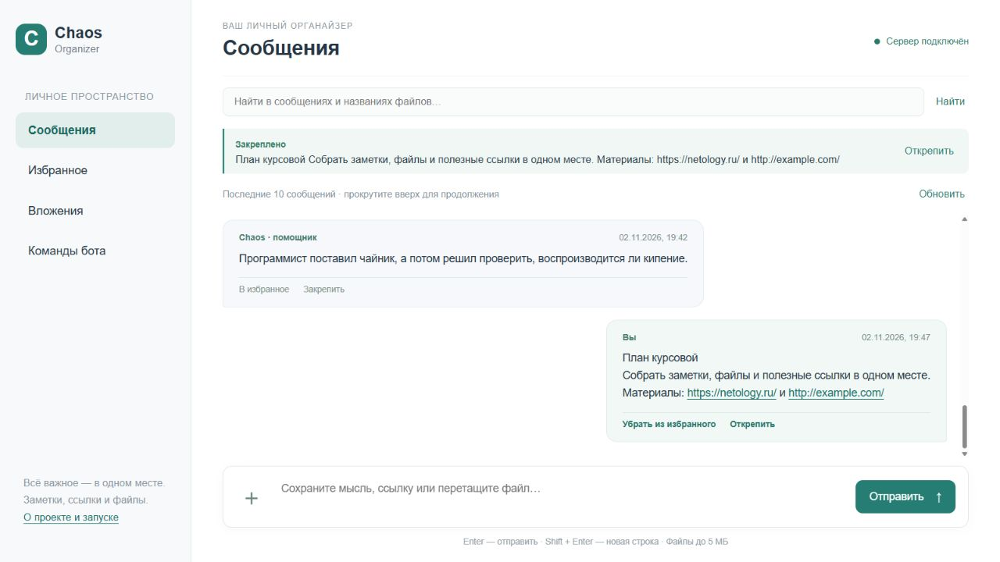
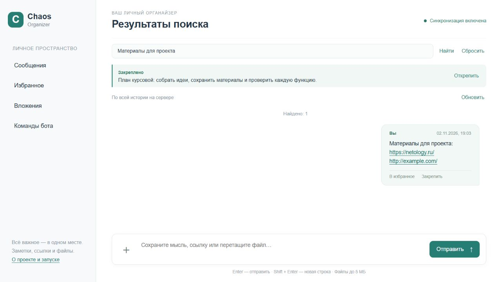
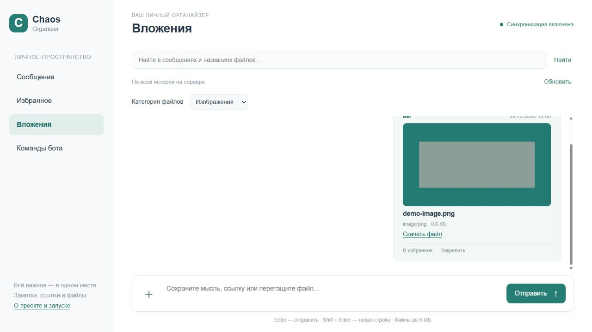
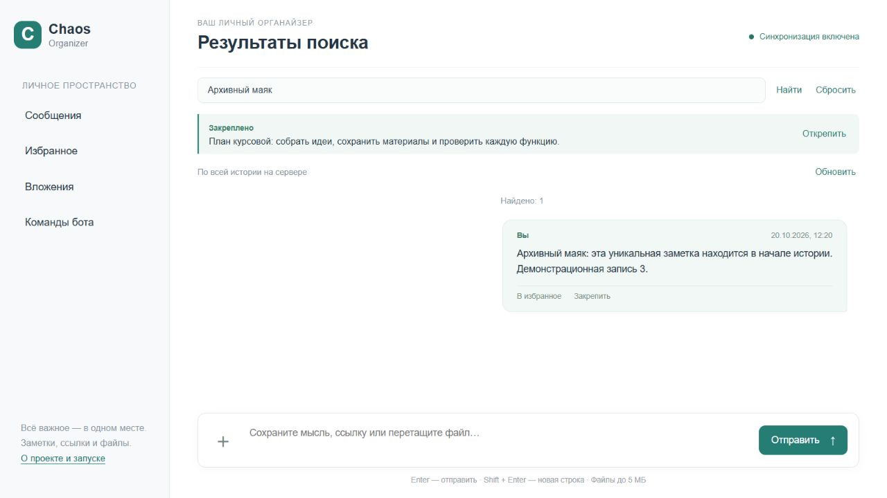
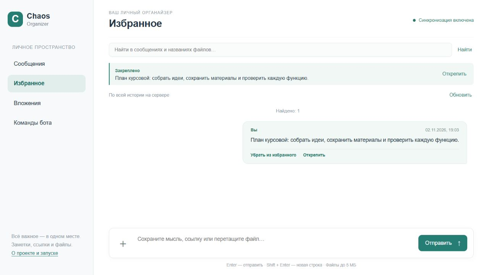
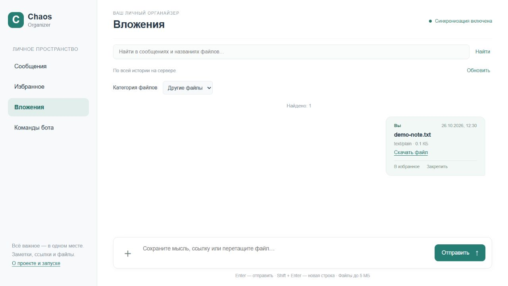
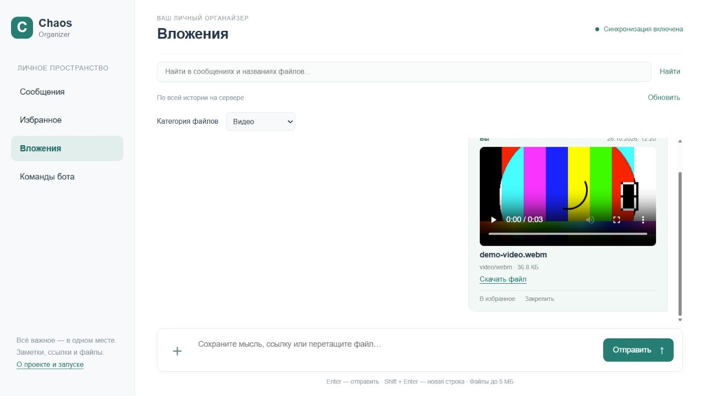
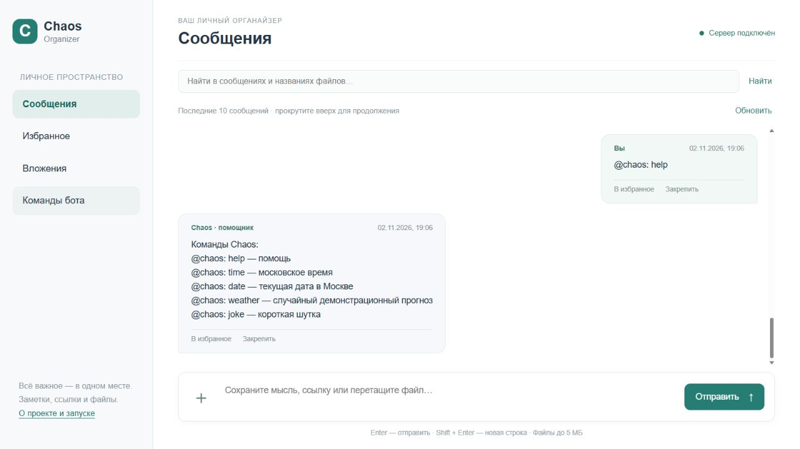

# Chaos Organizer

[](https://github.com/GODY1403/ahj-diploma/actions/workflows/pages.yml)
[](https://ci.appveyor.com/project/GODY1403/ahj-diploma/branch/main)

Однопользовательский бот-органайзер: заметки, ссылки, файлы и поиск в интерфейсе мессенджера. Курсовая работа по модулю «Продвинутый JavaScript в браузере».

[Официальное задание](https://github.com/netology-code/ahj-diploma) · [GitHub Pages](https://gody1403.github.io/ahj-diploma/)

**Публичный запуск проверен:** frontend на [GitHub Pages](https://gody1403.github.io/ahj-diploma/) подключён к [backend на Render Free](https://ahj-diploma-api.onrender.com/api/health). Адрес задан переменной GitHub Actions `CHAOS_API_URL`. Реальные HTTPS/WSS-запросы и основные сценарии опубликованного приложения проверены 2 ноября 2026 года. AppVeyor подключён и успешно выполняет проверки и создание артефакта; публикацию Pages выполняет GitHub Actions.

Все изображения ниже — настоящие скриншоты работающего приложения. Главная страница снята на GitHub Pages с backend Render; остальные изображения — при локальной проверке.



## Возможности и использование

Реализованы все **5 обязательных пунктов** официального задания и **7 дополнительных функций**.

### Текст и ссылки

Введите заметку в нижнее поле и нажмите «Отправить» или Enter. Shift + Enter добавляет перенос строки. Поддерживаются сообщения до 20 000 символов и длинные слова. Ссылки `http://` и `https://` становятся кликабельными и открываются в новой вкладке. Пользовательский текст выводится безопасно через текстовые DOM-узлы.

Сообщения сохраняются на сервере с `id` и датой создания. Обновление страницы повторно загружает их через API; localStorage для хранения истории не используется.



### Файлы и скачивание

Нажмите «＋» и выберите файл либо перетащите его в рабочую область чата. Файл отправляется на backend через FormData. Изображения получают предварительный просмотр; у каждого вложения есть имя, тип, размер и ссылка «Скачать файл».

Скачивание всегда идёт с сервера. Имя и MIME-тип сохраняются, включая имена на русском языке. Лимит одного файла — **5 МБ**, всех файлов в памяти — **50 МБ**. Превышение лимита сопровождается сообщением об ошибке. Файлы SVG доступны для скачивания без встраивания в страницу.



### Ленивая история

В разделе «Сообщения» сначала запрашиваются только последние **10** записей. Прокрутите историю вверх, чтобы получить следующие 10. Сервер возвращает записи по курсору `before`, а не всю историю сразу. Уже загруженные сообщения не повторяются; видимая позиция при добавлении старых записей сохраняется. Над началом истории появляется соответствующая надпись.

При запуске создаются **34 текстовые демозаписи и 4 вложения**, поэтому подгрузку можно проверить сразу. Например, «Архивный маяк» находится в ранней части истории.

### Поиск

Введите слово или фразу в верхнее поле и нажмите «Найти». Поиск без учёта регистра выполняется **на сервере по всей истории**, включая имена вложений. Результаты содержат текст и дату. Кнопка «Сбросить» возвращает историю; пустой запрос и отсутствие совпадений обрабатываются отдельно.

Чтобы проверить поиск вне первой страницы, введите `Архивный маяк` сразу после запуска.



### Закрепление и избранное

Нажмите «Закрепить» под сообщением. Единственная закреплённая запись появится сверху; новое закрепление заменяет прежнее. Кнопка «Открепить» доступна в верхней панели и у самой записи.

«В избранное» добавляет сообщение в серверный список. Откройте раздел «Избранное» слева, чтобы просмотреть его. «Убрать из избранного» удаляет отметку. Оба состояния сохраняются после обновления страницы, пока работает процесс сервера.



### Вложения по категориям

Откройте «Вложения» и выберите категорию: «Изображения», «Видео», «Аудио», «Другие файлы» или все сразу. Фильтрация выполняется на сервере по **всем сохранённым вложениям**, независимо от загруженной страницы истории. Предпросмотр, плеер и скачивание доступны в этом же разделе.



### Воспроизведение аудио и видео

Нажмите кнопку воспроизведения в стандартном плеере вложения. Источник — серверный файл; поддерживаются HTTP Range-запросы для загрузки частей. Используются форматы и кодеки, поддерживаемые вашим браузером. Для проверки в проект включены настоящий WAV и WebM; неподдерживаемый файл можно скачать.



### Команды бота

Отправляйте команды обычными сообщениями. Меню «Команды бота» позволяет подставить команду в поле, после чего нужно нажать «Отправить».

| Точный синтаксис | Ответ |
| --- | --- |
| `@chaos: help` | Список пяти команд |
| `@chaos: time` | Действительное текущее московское время |
| `@chaos: date` | Текущая дата в Москве |
| `@chaos: weather` | Случайный **демонстрационный** прогноз, без внешнего API |
| `@chaos: joke` | Случайная короткая шутка из подготовленного набора |

Команда и ответ бота сохраняются в серверной истории. Неизвестная команда возвращает подсказку.



### Синхронизация вкладок

Откройте приложение в двух вкладках с одним адресом API. Новые сообщения, загруженные файлы, избранное и закрепление отражаются без обновления страницы. HTTP и WebSocket используют одни и те же `id`, поэтому сообщения не дублируются. Новое сообщение не сбивает позицию при чтении старой истории. После разрыва клиент повторяет подключение и загружает актуальное состояние сервера.

## Локальный запуск

Нужен **Node.js 24.22.1 LTS** и npm. У frontend и backend отдельные `package.json` и `package-lock.json`; Git-репозиторий один.

В первом терминале из папки проекта:

```bash
cd backend
npm ci
npm start
```

Во втором:

```bash
cd frontend
npm ci
npm start
```

Откройте `http://localhost:8080/`. Backend по умолчанию слушает `http://localhost:3000/`; другой порт задаётся переменной `PORT`.

Адрес API задаётся переменной `API_URL` **до запуска или сборки** frontend. Например, в PowerShell:

```powershell
$env:API_URL = 'http://localhost:3000/'
npm start
```

В production-сборке без `API_URL` localhost не подставляется: приложение честно сообщает об отсутствии публичного сервера. Адрес WebSocket `/ws` вычисляется из HTTP-адреса; HTTPS автоматически превращается в WSS.

## Проверки

```bash
cd backend
npm test
npm audit
npm audit --omit=dev
```

```bash
cd frontend
npm run lint
npm run build
npm audit
```

Автоматические тесты Node.js проверяют настоящие HTTP-запросы: страницы 10 + 10 + 10 + 8, порядок и уникальность, устойчивость курсора при новых сообщениях, пустую историю, текст, поиск ранних записей, закрепление, избранное, категории, команды и ошибки. Для PNG, WAV, WebM и текста сравниваются скачанные байты, имена, MIME-типы и Range-ответы; проверяется отказ при превышении 5 МБ. Отдельный тест использует две настоящие WebSocket-сессии.

В настоящем браузере проверены ссылки и безопасный длинный текст, загрузка через выбор файла, скачивание PNG/WAV/WebM, подгрузка с сохранением позиции, поиск, избранное, закрепление, категории, все команды, воспроизведение WAV и WebM, повторная загрузка страницы, ошибки 404 и недоступность API, две вкладки и автоматическое восстановление соединения. Файловые события `dragenter`, `dragover` и `drop` проверены браузерным стендом с настоящей отправкой файла на backend. Физическое перетаскивание PNG из Проводника на GitHub Pages, появление изображения и скачивание вручную подтверждены владельцем проекта 2 ноября 2026 года. В чистой рабочей сессии ошибок JavaScript в консоли не обнаружено.

В инструментах frontend установлен override `minimatch@11.0.1`, исправляющий [GHSA-g3hv-75wg-m249](https://github.com/advisories/GHSA-g3hv-75wg-m249). Работа ESLint и его шаблонов файлов проверена с этой версией.

Ручной workflow **Check public API** проверяет настоящий HTTPS/WSS-сервер из `CHAOS_API_URL`: историю, поиск, файлы и скачанные байты, закрепление, избранное, категории и команды. Он добавляет небольшие проверочные сообщения и файлы в общее демонстрационное пространство. Запускайте его отдельно через Actions → Run workflow.

Публичная проверка [HTTPS/WSS API](https://github.com/GODY1403/ahj-diploma/actions/runs/41482653176) прошла успешно. Непосредственно на GitHub Pages в браузере проверены страницы истории по 10 записей, поиск раннего сообщения, отправка текста и ссылки, загрузка PNG/WAV/WebM кнопкой, скачивание всех четырёх типов файлов, воспроизведение WAV и WebM, закрепление с заменой и откреплением, избранное после обновления страницы, категории, пять команд и синхронизация двух вкладок без дублей. Превышение 5 МБ показывает понятную ошибку и не блокирует дальнейшую работу. Ошибок JavaScript в рабочей сессии не обнаружено. Недоступность сервера проверена локально. Физический Drag & Drop из Проводника на публичном сайте и последующее скачивание подтверждены владельцем проекта.

## API

Все маршруты относятся к одному общему пространству. JSON-запросы передаются с `Content-Type: application/json`.

| Метод и маршрут | Назначение |
| --- | --- |
| `GET /api/health` | Проверка доступности |
| `GET /api/messages?before=<id>` | До 10 более старых записей: `{ messages, hasMore, nextCursor }`; без курсора — последние 10 |
| `POST /api/messages` | `{ "text": "Заметка" }` → `{ messages }`; команда создаёт также ответ бота |
| `POST /api/files` | FormData с полем `file` → сообщение-вложение |
| `GET /api/files/:id` | Файл для предпросмотра или воспроизведения, поддержка Range |
| `GET /api/files/:id/download` | Скачивание с правильным именем и MIME-типом |
| `GET /api/search?q=<текст>` | Поиск по всей истории |
| `GET /api/favorites` | Все избранные сообщения |
| `PATCH /api/messages/:id/favorite` | `{ "isFavorite": true }` или `false` |
| `GET /api/pin` | Единственное закреплённое сообщение или `null` |
| `PUT /api/pin` | `{ "id": "..." }` — заменить закрепление |
| `DELETE /api/pin` | Открепить сообщение |
| `GET /api/attachments?category=<категория>` | `all`, `images`, `video`, `audio`, `other` |
| `WS /ws` | Уведомления `ready`, `messages`, `pin`, `favorite`; изменения выполняются через HTTP |

При ошибках API возвращает соответствующий HTTP-статус и `{ "error": "Понятное сообщение" }`. Авторизации и базы данных нет.

## Публикация

### GitHub Actions и Pages

Workflow `.github/workflows/pages.yml` запускается при push в `main` и вручную: чистая установка обеих частей, серверные тесты, ESLint, аудит, production-сборка и публикация `frontend/dist` штатным механизмом GitHub Pages. Сборка использует переменную репозитория **`CHAOS_API_URL`**.

В Settings → Pages выберите Source: **GitHub Actions**. Публичные ресурсы собираются с относительными путями и работают в подпапке `/ahj-diploma/`.

### Backend на Render Free

Сервис [ahj-diploma-api.onrender.com](https://ahj-diploma-api.onrender.com/api/health) развёрнут по `render.yaml`: Node.js 24.22.1, Root Directory `backend`, Build Command `npm ci`, Start Command `npm start`, тариф **Free**, порт из `PORT`, проверка `/api/health`. Для повторного развёртывания:

1. Войдите в свой аккаунт Render → New → Blueprint.
2. Подключите `GODY1403/ahj-diploma`, ветку `main`, и примените `render.yaml`. Перед созданием проверьте тариф **Free**.
3. Дождитесь статуса Live и откройте `https://<имя-сервиса>.onrender.com/api/health`: ожидается `{ "status": "ok" }`.
4. В GitHub → Settings → Secrets and variables → Actions → Variables добавьте `CHAOS_API_URL` с HTTPS-адресом сервера, заканчивающимся `/`.
5. Запустите Build and deploy через Actions → Run workflow и проверьте операции на опубликованной странице.

Платные ресурсы не нужны. После повторного развёртывания проверяйте реальные операции через HTTPS API и опубликованный интерфейс.

### AppVeyor

AppVeyor подключён: [сборка 1.0.2 завершилась со статусом Success](https://ci.appveyor.com/project/GODY1403/ahj-diploma/builds/55014205). `appveyor.yml` устанавливает Node.js 24.22.1 и зависимости обеих частей, запускает серверные тесты, npm audit, ESLint и production-сборку Webpack, затем сохраняет артефакт `chaos-frontend.zip`.

Фактическую публикацию GitHub Pages выполняет GitHub Actions при push в `main` или ручном запуске workflow. Переменная `PAGES_DEPLOY_TOKEN` **не настроена**, поэтому AppVeyor не инициирует GitHub Actions через API: этот необязательный шаг пропускается без ошибки. В конфигурации сохранена возможность такого запуска при наличии защищённой переменной. Для клиентского артефакта AppVeyor можно отдельно задать `API_URL` в его настройках; сборка Pages использует `CHAOS_API_URL` в GitHub.

Требование официального задания об AppVeyor выполнено работающей интеграцией. Старые упоминания Heroku заменены развёртыванием backend на Render; публикация frontend настроена через GitHub Actions.

## Ограничения и демонстрационные данные

- Сообщения, избранное, закрепление и загруженные файлы находятся только в памяти процесса. После перезапуска, в том числе при автоматическом развёртывании Render, изменения исчезают, а стартовые демоданные создаются заново.
- Render Free может засыпать при простое; первый запрос после сна может занять около минуты. Повторное соединение не восстанавливает утраченное содержимое памяти.
- Это **одно общее пространство без авторизации**. Любой посетитель публичного URL может читать и добавлять данные. Проект не предназначен для конфиденциальной информации или производственной работы.
- PNG, тон WAV, тестовый ролик WebM и текст в `backend/demo` созданы специально для проекта. Чужие приватные файлы не используются.
- Поиск и отдельные списки избранного/вложений предназначены для небольшого учебного набора; ленивая серверная пагинация применяется к основной истории.
- Публичное приложение проверено отдельно через HTTPS/WSS и в браузере, включая ручное подтверждение Drag & Drop владельцем проекта.
